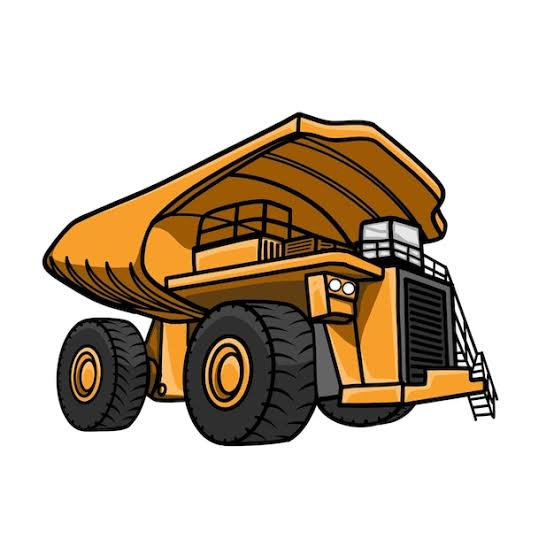

  

# Opencast Pit Planning & Economics Study

An Excel model that takes a coal deposit from **borehole data to a go/no-go answer**: how much coal is in the pit, which blocks are worth mining, how steep the walls can be, how many machines are needed, whether blasting is safe, and what the project is worth after tax (NPV, IRR, payback).

> **Sample data only.** Every input is an illustrative value in a typical range. It is **not** data from any real mine. Replace the yellow cells with textbook or published figures to run your own case.

## Key results (sample dataset, default settings)

| Result | Value |
|---|---|
| Coal in place | 2.21 million t |
| Recoverable coal (economic blocks) | 1.69 million t |
| Break-even stripping ratio | 4.21 m³/t |
| Blocks worth mining | 16 of 20 |
| Fleet required | 2 excavators, 7 dumpers |
| All-in cost / profit per tonne | ₹2,055 / ₹145 |
| Mine life | 3.4 years |
| Kriged seam thickness at target point | 8.39 m ± 0.70 m (95 %) |
| Overall pit slope / planar-failure FoS | 43.1° / 1.34 (meets target 1.3) |
| Blast vibration (PPV) vs DGMS limit | 2.8 mm/s vs 10 mm/s, within limit |
| Pre-tax NPV (10 %) | ₹9.9 crore |
| **Post-tax NPV / IRR / payback** | **−₹3.6 crore / 4.8 % / 3.6 years** |
| Largest NPV driver | Coal price |

**Verdict: marginal.** Pre-tax the project looks viable on average, but once the pit-slope overburden, the equipment capital and 25 % tax are included, the post-tax NPV is slightly negative at a 10 % discount rate. This is what a more complete model should show: the starter version ignored these costs.

## What is in the workbook

| Sheet | Question it answers | Topic |
|---|---|---|
| **How to use** | Reading order, colour code, experiments | |
| **Inputs** | All assumptions in one place (12 sections) | |
| **Reserve** | Coal and overburden per block; which blocks are economic | Reserve estimation |
| **Geostatistics** | How continuous is the seam? Kriged value at an unsampled point | Geostatistics |
| **Pit design** | Bench geometry, overall slope, slope-wedge overburden, factor of safety | Slope stability |
| **Fleet** | Excavators and dumpers needed for the target | Equipment selection |
| **Safety** | Blast vibration vs DGMS limit; loaded-dumper stopping distance | Mine safety (OHS) |
| **Quality and royalty** | Washability, wash-or-sell, royalty, DMF, NMET | Mineral processing, legislation |
| **Economics** | Cost per tonne and break-even stripping ratio | Mine economics |
| **Cash flow** | Year-by-year pre-tax profit and NPV | |
| **Mine planning** | Taylor's rule, effective cut-off stripping ratio, daily movement | Mine planning |
| **Finance** | Depreciation, tax, post-tax NPV, IRR, payback | Financial analysis |
| **Sensitivity** | Which assumption moves the NPV most (tornado chart) | |
| **Summary** | All key results on one page | |

Every number is a live formula (about 2,950 in total, no macros). Colour code: blue text on yellow = input, black = formula, green = pulled from another sheet.

## Methods

**Reserve and economics (core model)**
1. Block volume = area × thickness; coal tonnes = volume × relative density; stripping ratio (SR) = overburden volume ÷ coal tonnes.
2. Break-even SR = (price − coal winning cost) ÷ overburden removal cost. Blocks above it are left out of the pit.
3. Fleet: machines = hours needed ÷ effective hours per machine, rounded up.

**Geostatistics**
- Experimental semivariogram from all 190 borehole pairs, binned by lag.
- Fitted model selectable: spherical, exponential or Gaussian (nugget, partial sill, range).
- Optional linear trend removal (least squares), then **ordinary kriging** on the residuals. The 21×21 kriging system is solved with `MMULT(MINVERSE())`.
- Output: kriged value, kriging variance, 95 % confidence interval, and comparison with polygon and inverse-distance estimates.

**Pit design**
- Overall slope: tan β = D ÷ (D ÷ tan α + (N − 1) × berm), from bench height D, face angle α, berm width and number of benches N.
- Slope-wedge overburden = ½ D² cot β × wall length, added to the stripping ratio.
- Planar failure (Hoek & Bray, dry slope, no tension crack): FoS = (cA + W cos ψp tan φ) ÷ (W sin ψp).
- Trade-off table of slope angle vs stripping vs FoS; ramp length from gradient.

**Mine planning**
- Taylor's rule: T = 6.5 × (reserve in Mt)^0.25 million t/yr (±25 %), compared with the target rate.
- Effective cut-off SR = break-even SR − slope-wedge burden per tonne.

**Quality and legislation**
- Float-and-sink table: cumulative yield and ash, yield at target ash by interpolation, cut-point density, organic efficiency, reject ash.
- Wash-or-sell comparison and break-even washed price.
- Statutory levies: royalty, District Mineral Foundation (30 % of royalty) and NMET (2 % of royalty), plus a placeholder for other levies.

**Safety**
- Scaled-distance law: PPV = K × (R ÷ √Qd)^−β. Safe distance and maximum charge per delay.
- Permissible PPV from the DGMS table (structure category × frequency band).
- Dumper stopping distance on a downgrade (reaction distance + braking with grade and friction).

**Finance**
- Equipment capital shown explicitly; ownership share removed from the hourly cash cost so it is not counted twice.
- Depreciation: straight line, written-down value or units of production (selectable).
- Tax on (profit − depreciation); residual sale value and terminal loss at closure.
- Post-tax NPV, IRR, payback, profitability index and depreciation tax shield, with a cross-check against Excel's `NPV()`.

| | |
|---|---|
|  |  |
|  |  |

## Three switches (Inputs, section 6)

The advanced modules plug into the original model through switches, so you can see what each one changes.

| Switch | Default | What it does when ON |
|---|---|---|
| Slope-wedge overburden | **1 (on)** | Adds wall rock outside the borehole grid to the stripping ratio |
| Statutory levies from build-up | 0 (off) | Uses royalty + DMF + NMET + other levies instead of the ₹900/t placeholder |
| Washed-coal product | 0 (off) | Sells washed coal (lower yield, higher price) instead of run-of-mine |

With all three at 0 the workbook reproduces the original starter results exactly (pre-tax NPV ₹19.1 crore, 6 dumpers, ₹211/t profit). The default has the wedge on, which is why pre-tax NPV is ₹9.9 crore and 7 dumpers are needed.

The levy build-up is off by default because the sample royalty build-up (about ₹417/t) is much lower than the old ₹900/t placeholder, and turning it on makes every block look economic. Check current rates before trusting it.

## How to use it

1. Open `Opencast_Pit_Planning_Economics.xlsx` in Excel, LibreOffice or Google Sheets and read the **How to use** sheet.
2. Go through the sheets in order, starting with **Inputs**.
3. Replace the sample borehole data on **Reserve** and the yellow cells on **Inputs** with your own data.

Experiments to try:
- Raise coal price from ₹2,200 to ₹2,600/t. What happens to the break-even SR, economic blocks and post-tax NPV?
- Switch the variogram model from spherical to Gaussian. How does the kriging variance change?
- Increase face angle from 70° to 75°. Stripping falls, but what happens to the FoS?
- Change the depreciation method. Does the NPV change, and why (tax shield timing)?
- Turn the levy switch on. Why does the number of economic blocks jump?

## Limitations

- Flat-lying seam, one borehole per block, one seam only
- One overall slope per block wall; corner wedges are ignored
- Planar failure only, dry slope, no tension crack or water pressure
- Variogram is isotropic and fitted by inspection; the trend is linear
- Sensitivity analysis holds the pit shell at the base case
- Tax has no loss carry-forward
- Cash flow table covers 10 years; extend it if the mine life is longer
- Stripping ratio is per tonne of coal in place, not per recoverable tonne, so cost per tonne sold is slightly understated
- **Verify before use:** NMET rate, the "other levies" figure and the DGMS table against the latest circulars; site constants K and β must come from blast monitoring
- Real mine planning uses software (e.g. Surpac, Datamine, Whittle) for 3D block models and optimised pit shells

## References

- Hoek, E. and Bray, J. W., *Rock Slope Engineering*: planar failure and factor of safety
- Taylor, H. K. (1986): mine life and production rate rule
- DGMS (Tech)(S&T) Circular No. 7 of 1997: permissible ground vibration
- Isaaks, E. H. and Srivastava, R. M., *An Introduction to Applied Geostatistics*: variogram and kriging
- MMDR Act 1957 (as amended): royalty, DMF and NMET provisions. Check current rates and notifications

## Tech

Microsoft Excel (formulas only, no macros). Built with Python (openpyxl) and checked with LibreOffice: 0 formula errors, results cross-checked independently in Python.

## Note on AI assistance

The workbook structure and sample values were built with AI assistance (Claude). The purpose of the project is to understand and explain each calculation, not to represent a real mine.
